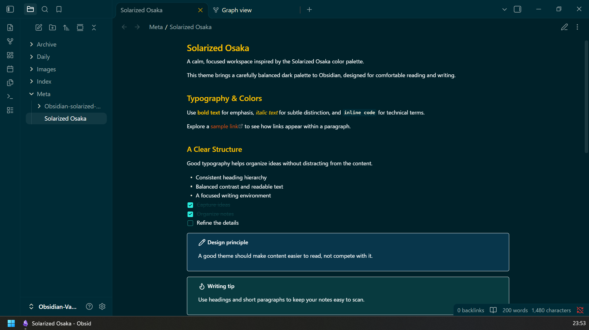
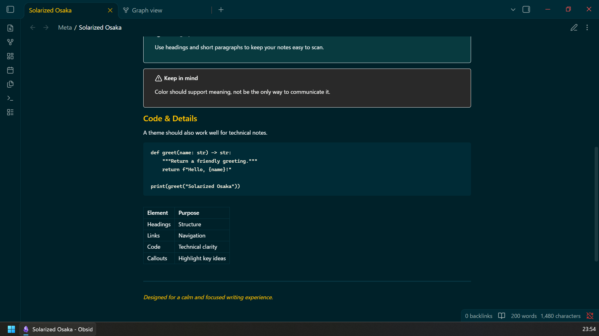
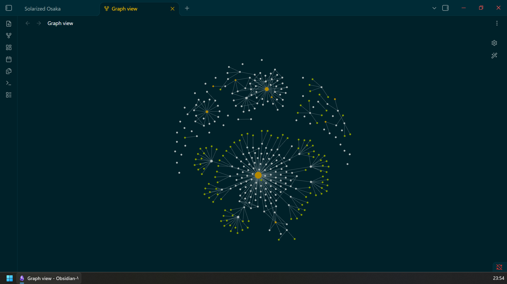

# Solarized Osaka

A dark Obsidian theme inspired by [Solarized Osaka](https://github.com/craftzdog/solarized-osaka.nvim) color palette.



## More Screenshots





## Inspirations and Credits

- [Solarized Osaka for Neovim](https://github.com/craftzdog/solarized-osaka.nvim) — Color palette inspiration.
- [Obsidian Gruvbox](https://github.com/insanum/obsidian_gruvbox) — Source of the CSS structure and styling adapted for the Solarized Osaka palette. Licensed under the MIT LICENSE.
- [Inkdrop Solarized Dark](https://github.com/inkdropapp/solarized-dark) — UI appearance and color palette reference.
- [Obsidian Sample Theme](https://github.com/obsidianmd/obsidian-sample-theme) — Development setup and theme structure reference.

## License

Original work in this project is licensed under the Zero-Clause BSD (0BSD) License. See [LICENSE](LICENSE) for details.

The CSS adapted from Obsidian Gruvbox is subject to MIT License. See [THIRD-PARTY-LICENSES](THIRD-PARTY-LICENSES) for the applicable license text and copyright notice.

## Development

This theme is based on the official [Obsidian sample theme](https://github.com/obsidianmd/obsidian-sample-theme).

Install the dependencies:

```bash
npm install
```

Run the CSS linter:

```bash
npm run lint
```

The theme's styles are defined in `theme.css`.
